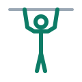
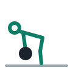

  

<h1 align="center">Calisthenics Workout</h1>

  One movement per day. High sets, high reps. 
   
  Based on Sober Fitness's <a href="https://www.youtube.com/watch?v=AQE6F7qLVTU">The Ultimate Workout Split</a>. 
  Master one exercise a day instead of spreading yourself thin.

---

## Week at a Glance

| Day | Focus | Movement |
|-----|--------|--------|
| [Monday](#monday) | Push | Bench press → dips |
| [Tuesday](#tuesday) | Pull | Barbell rows |
| [Wednesday](#wednesday) | Legs | Squats → bar hangs |
| [Thursday](#thursday) | Push | Overhead or incline press → raises |
| [Friday](#friday) | Pull | Wide-grip pull-ups |
| [Saturday](#saturday) | Legs / Posterior | Romanian deadlifts |
| [Sunday](#sunday) | Recovery | Stretch, walk, hike, or easy run |

**How it works**
- **10 × 10** on the main movement. Pick a weight you could lift for about 20 reps fresh (roughly 50–60% of your max). The first sets feel easy; the last ones shouldn't.
- **Rest 60–90 seconds** between sets. Keep the session moving.
- **Progress:** When you hit all 10 × 10 with clean form, add weight next week: 5 lb for upper body, 10 lb for legs. If you miss reps, keep the weight and beat last week's total.
- **Any level:** Every day lists an easier and a harder version. Use whichever lets you finish the sets with good form.

---

## Monday

### Push — Bench Press

**Main movement**
- **Flat barbell bench press** · 10 × 10 — Feet planted, shoulder blades pinched back, lower the bar to mid-chest, press up. Use a spotter or safety pins.

**Finisher**
- **Dips** · 3 × max reps — Parallel bars, lean slightly forward, lower until shoulders are just below elbows, press up. Stop 1–2 reps short of failure.

**Easier / harder**
- **Easier:** Dumbbell bench press or push-ups for the main movement; bench dips or band-assisted dips for the finisher.
- **Harder:** Pause each rep for 1 second on the chest; add weight to the dips.

**Tip:** Pick a weight you can own for all ten sets. It's a volume day, not a max day.

---

## Tuesday

### Pull — Barbell Rows

**Main movement**
- **Barbell row** · 10 × 10 — Hinge to about 45°, back flat, pull the bar to your lower ribs, squeeze, lower under control. No jerking it up with your hips.

**Easier / harder**
- **Easier:** Chest-supported dumbbell rows or inverted rows under a bar or table.
- **Harder:** Pendlay rows (bar returns to the floor each rep) or a 2-second squeeze at the top.

**Tip:** If your lower back gives out before your upper back does, switch to chest-supported rows for the last few sets.

---

## Wednesday

### Legs — Squats

**Main movement**
- **Barbell back squat** · 10 × 10 — Brace, sit down between your heels to at least parallel, drive up through mid-foot. Use safety pins.

**Finisher**
- **Bar hangs** · 3 × 30–60 seconds — Dead hang from a pull-up bar, fully relaxed, to decompress the spine after squatting.

**Easier / harder**
- **Easier:** Goblet squats or bodyweight squats; shorter hangs split into pieces.
- **Harder:** Pause squats (2 seconds at the bottom) or front squats.

**Tip:** "Heavy" here means heavy for ten sets of ten. Leave a rep or two in the tank on the early sets.

---

## Thursday

### Push — Overhead Press

**Main movement**
- **Overhead press or incline press** · 10 × 10 — Standing barbell overhead press, or barbell/dumbbell incline press if your shoulders prefer it. Pick one and stay with it for the block.

**Finishers**
- **Rear-delt raises** · 4 × 15–20 — Bent over with light dumbbells, raise out to the sides, lead with the elbows.
- **Lateral raises** · 4 × 15–20 — Standing, light dumbbells, raise to shoulder height, lower slowly.

**Easier / harder**
- **Easier:** Seated dumbbell press; band pull-aparts in place of rear-delt raises.
- **Harder:** Push press for the last few sets; slow 3-second lowering on the raises.

**Tip:** Go light on the raises. Strict reps beat swinging.

---

## Friday

### Pull — Wide-Grip Pull-Ups

**Main movement**
- **Wide-grip pull-ups** · 100 total reps — Hands a bit wider than shoulders, pull your chest toward the bar, lower all the way. Take as many sets as you need; aim for fewer sets over time.

**Easier / harder**
- **Easier:** Band-assisted pull-ups, negatives (jump up, lower for 3–5 seconds), or lat pulldowns at 10 × 10.
- **Harder:** 10 × 10 straight sets, then add weight.

**Tip:** Track how many sets it takes to reach 100. That number dropping is your progress.

---

## Saturday

### Legs / Posterior — Romanian Deadlifts

**Main movement**
- **Romanian deadlift (RDL)** · 10 × 10 — Soft knees, push your hips back, slide the bar down your thighs until you feel the hamstrings stretch, then stand tall. Back stays flat.

**Easier / harder**
- **Easier:** Dumbbell RDLs or single-leg RDLs with bodyweight.
- **Harder:** 3-second lowering, or a deficit (stand on a small plate).

**Tip:** The stretch is the point. Stop where your back would start to round, not where the floor is.

---

## Sunday

### Recovery

Move easy and let the week soak in.

- Stretch: hips, hamstrings, chest, shoulders
- Light walk, hike, or easy run
- Play with the kids

**Optional:** Light skill play from [The 6 "Holy Grail" Exercises (PDF)](The_6_Exercises.pdf), nothing taxing.

**Tip:** Rest is part of the program. Monday's bench depends on it.
